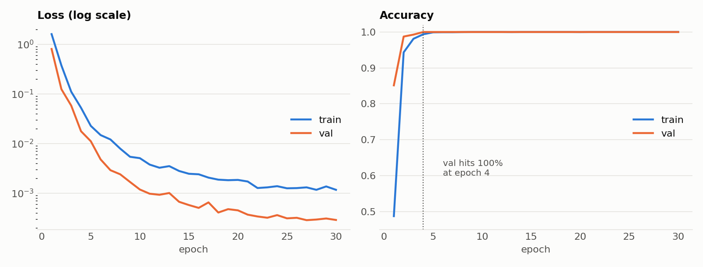

# CWRU bearing fault classification

A small 1D CNN that classifies bearing faults from raw vibration signals in the [CWRU bearing dataset](https://engineering.case.edu/bearingdatacenter). It is a training example, not a production system. The code is short on purpose so you can read all of it.

The dataset has 10 classes: normal, plus inner race, ball and outer race faults at three sizes each (0.007, 0.014 and 0.021 inch). Each recording is cut into windows of 1200 samples (0.1 s at 12 kHz).

## Results

One run with the default config, using bf16 on a laptop RTX 3060 (6 GB):

| Split | Windows | Accuracy |
|---|---|---|
| Train | 5559 | 1.0000 |
| Validation | 552 | 1.0000 |
| Test | 552 | 1.0000 |



Every split scores 100%, which says the pipeline works and not much else. CWRU is an easy benchmark, and train, validation and test all come from the same 40 recordings. They are split in time with a gap, so no window crosses a boundary, but the same motor, sensor and loads appear in every split. A stricter test would hold out a whole motor load.

## Setup

```powershell
pip install -r requirements.txt
python download_data.py
python train.py
python evaluate.py --checkpoint runs/cwru-cnn1d/best.pt
```

`download_data.py` fetches the 40 required `.mat` files (numbers 97 to 237, listed in `CWRU_FILES` in `cwru.py`) into `data/raw/cwru`. If the download fails, get them by hand from the Normal Baseline Data and 12k Drive End Bearing Fault Data pages and put them in the same folder.

## Files

```text
config.yaml        all settings
config.py          pydantic models for config.yaml, so a typo is an error
cwru.py            load .mat files, split in time, window, normalize, DataLoaders
cnn.py             the model
train.py           training loop, saves runs/.../best.pt, prints the test score
evaluate.py        per-class precision and recall and a confusion matrix
download_data.py   download the CWRU files
```

## Settings

Everything lives in `config.yaml`. To try something else, copy the file and run `python train.py --config my_experiment.yaml`.

| Feature | Off | On |
|---|---|---|
| Mixed precision | `precision: fp32` | `fp16` (CUDA, uses a GradScaler) or `bf16` |
| Gradient accumulation | `grad_accum_steps: 1` | for example `4` |
| Weights & Biases | `wandb.enabled: false` | `true` (run `wandb login` once) |

## Data handling

- Each recording is split in time (70/15/15) before windowing, with a gap between the pieces.
- Normalization uses the mean and std of the training windows only.
- The normal recordings look like 48 kHz, while the fault recordings are 12 kHz, so the normal ones are decimated by 4 with an anti-aliasing filter. CWRU does not state the rate for the normal files. The assumption comes from their length, about four times the fault files for the same duration.
